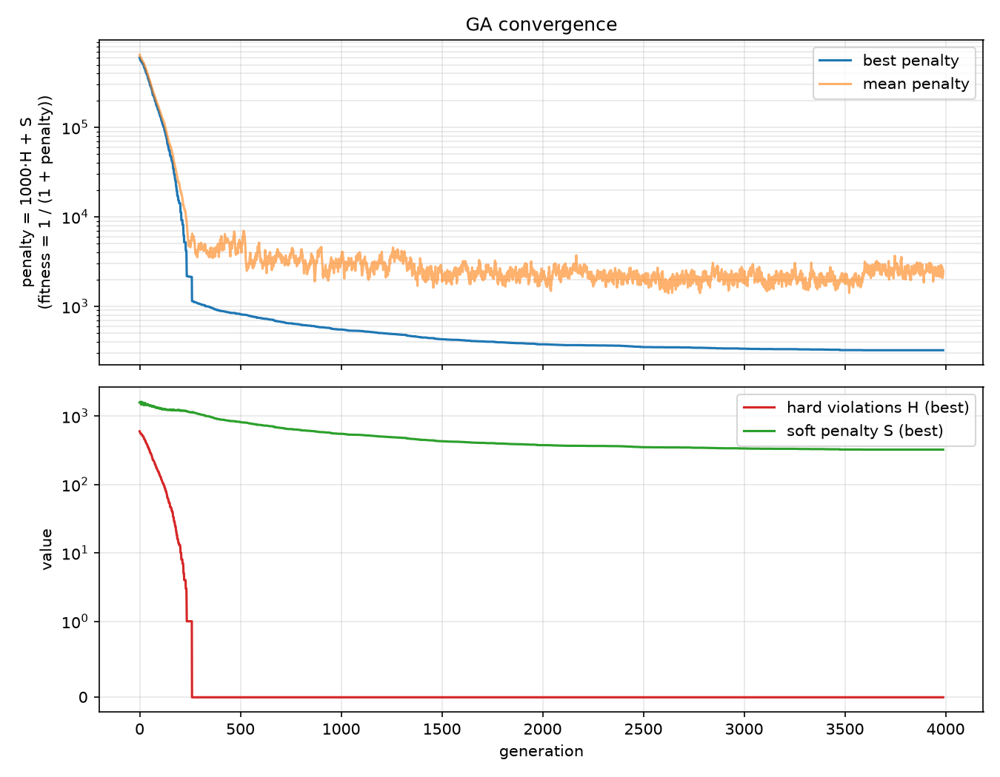

# class-scheduling-ga

A genetic algorithm that builds a weekly university timetable: it assigns every class session a professor, a day, a timeslot and a room.
It satisfies hard constraints such as no double-booked rooms or professors, and optimises soft preferences such as compact days and well-sized rooms.



## The problem

The default instance has:

- 60 courses with 8 sections each, so 480 sections.
- 2 sessions per section, so 960 sessions to place.
- 60 professors, 35 rooms, 5 days and 6 timeslots per day.
- Rooms and sections come in three sizes: Small, Average and Large.
- Every professor has a list of 5 courses they can teach, and 3 of those are favourites.

**Hard constraints** (must hold):

- A room is at least as large as the section's registration size.
- The two sessions of a section are on different, non-adjacent days.
- A professor teaches at most one session at a time and at most 20 sessions per week.
- A room hosts at most one session at a time, and a section is never in two rooms at once.
- A professor only teaches courses on their list.

**Soft constraints** (minimised):

- Idle gaps in a professor's day.
- Professor days that mix morning (timeslots 1-3) and afternoon (timeslots 4-6).
- Courses whose sessions are split between morning and afternoon.
- Rooms that are larger than needed.
- Professors who teach none of their favourite courses.

The instance is generated from a seed.
The generator checks that every room-size tier has enough capacity, so a feasible room assignment always exists.

## How it works

**Encoding.**
A schedule is a `480 x 6` integer matrix, with one row `[professor, day pair, slot 1, slot 2, room 1, room 2]` per section.
The day-pair gene indexes the six legal pairs (Mon-Wed, Mon-Thu, Mon-Fri, Tue-Thu, Tue-Fri, Wed-Fri), so the day constraints can never be broken.
Random genes are drawn only from qualified professors and from rooms that are large enough.

**Fitness.**
`penalty = 1000 * H + S` and `fitness = 1 / (1 + penalty)`.
`H` counts hard violations and `S` is the weighted sum of the soft terms.
The evaluation is vectorised with NumPy and takes about 0.1 ms per schedule.

**Genetic algorithm.**
It uses tournament selection, uniform crossover on whole section rows, low-rate mutation and elitism.
It stops early once the schedule is feasible and has not improved for 400 generations.

**Conflict-directed repair.**
With rooms about 91% occupied, random mutation alone cannot remove room clashes.
So every child goes through a repair step:

- It finds the sections involved in a clash.
- It moves them to a time where the professor and a fitting room are free.
- It picks the smallest free room that fits.

Once a child has no clashes, the same step moves sessions into their course's preferred half of the day.

## Results

Seed 42, population 150, about 4 minutes on a laptop CPU:

| Metric | Value |
|---|---|
| Hard violations at generation 0 | 598 |
| First schedule with no hard violations | generation 260 |
| Final hard violations | 0 |
| Final penalty | 323 (from 599 570 at the start) |
| Professors with at least one favourite course | 60 of 60 |
| Sessions in a room of exactly the right size | 96.4% |
| Sessions in their course's preferred half of the day | 91.4% |

The full breakdown is in [`outputs/summary.json`](outputs/summary.json).

## Quick start

Requires Python 3.14+ and [uv](https://docs.astral.sh/uv/).

```bash
uv sync
uv run pytest                    # 13 tests
uv run python main.py --seed 42  # about 4 minutes, writes outputs/
```

Options: `--seed`, `--generations`, `--pop` and `--out`.
The GA parameters are in `GAConfig` in `ga.py`.

## Outputs

| File | Content |
|---|---|
| `schedule.csv` | One row per session: section, course, professor, day, timeslot, room, sizes, favourite flag |
| `timetable_rooms.txt` | Weekly grid for every room |
| `timetable_profs.txt` | Weekly grid for every professor, with their course list and favourites |
| `fitness.png`, `fitness.pdf` | Best and mean penalty, and `H` and `S` per generation |
| `history.csv` | The per-generation data behind the plot |
| `summary.json` | Final penalty breakdown, configuration and runtime |
| `numbers.tex` | Key results as LaTeX macros, for documents that quote them |

## Project layout

| File | Purpose |
|---|---|
| `instance.py` | Seeded instance generator and the capacity check |
| `fitness.py` | Vectorised fitness function |
| `ga.py` | Genetic algorithm and the repair operator |
| `main.py` | Command-line entry point that writes all outputs |
| `tests/test_fitness.py` | Loop-based reference checker and constraint tests |

## Tests

The vectorised fitness is compared with an independent, loop-based implementation on random schedules.
Other tests inject each kind of hard violation, check that repair keeps a feasible schedule feasible, and check the generated instance.

## License

[MIT](LICENSE)
